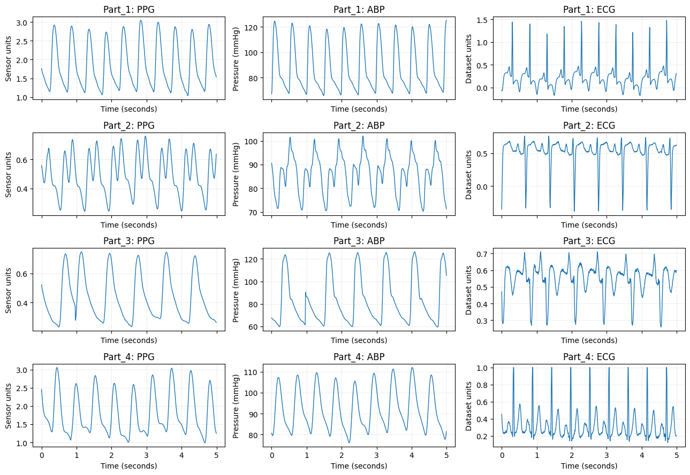
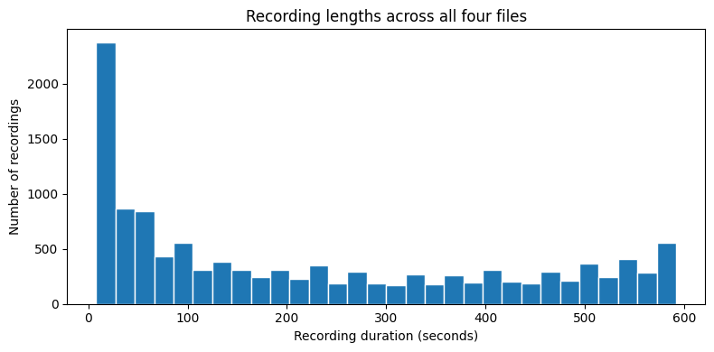
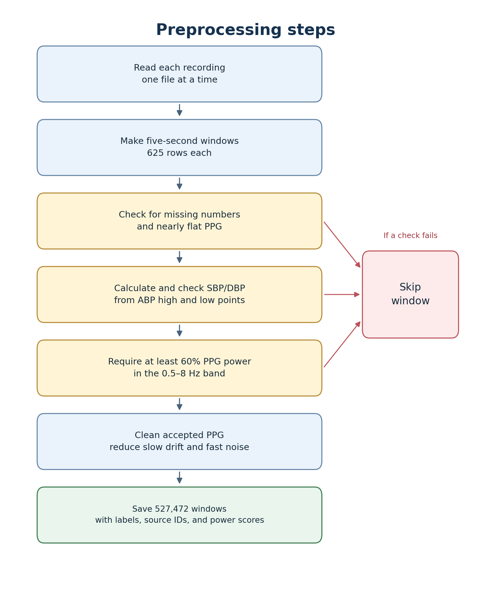
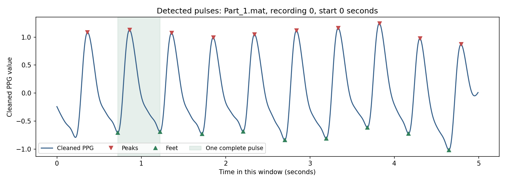
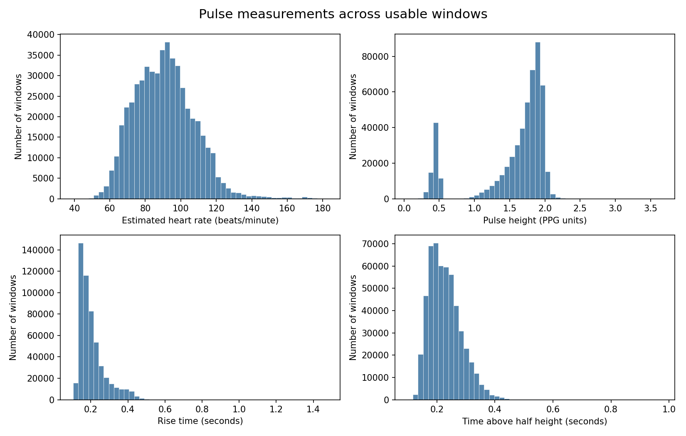
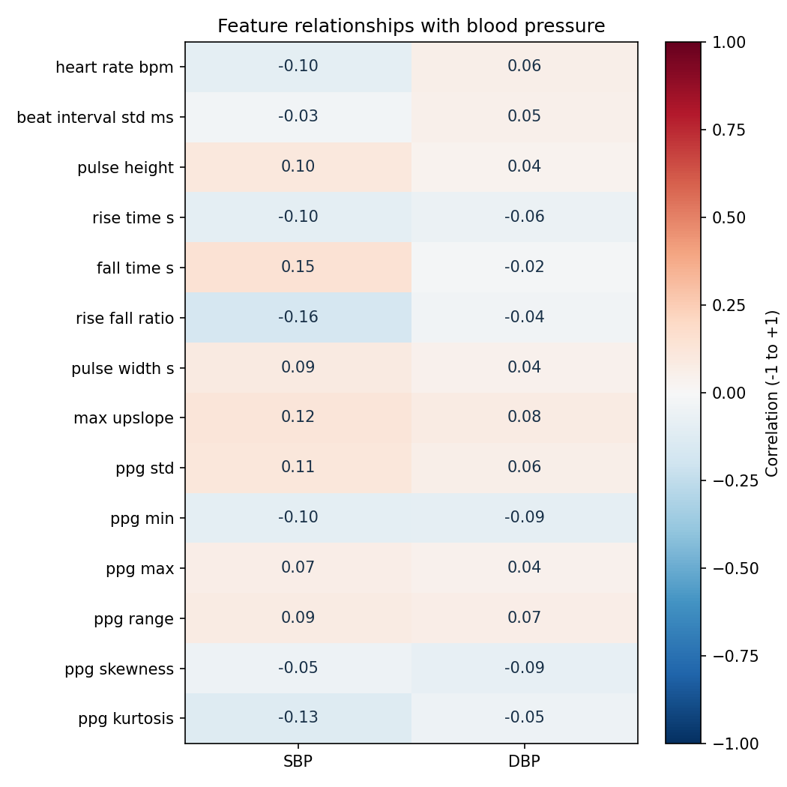

# Notebook results

## [dataset_overview.ipynb](../notebooks/dataset_overview.ipynb)

**Purpose:** Explore the data.

### Findings

- There are **four files**.
- Each file holds **3,000 separate tables**. Each table is one recording.
- Each row contains three readings taken together:
  - **PPG:** Light measures changes in blood under the skin.
  - **ABP:** Measures blood pressure inside an artery.
  - **ECG:** Measures the heart's electrical activity.
- **125 rows make one second** of recording.
- Each recording can have a different length.
- A five-second piece contains **625 rows**.

### Signal graphs

- The lines show how readings rise and fall over time.
- Moving from left to right means time is passing.
- Each row of graphs shows an example from one file.
- Each column shows one signal: PPG, ABP, or ECG.
- These graphs show five seconds from one recording in each file.

### Recording-length graph

- This graph shows how many recordings are short or long.
- Left means shorter recordings. Right means longer recordings.
- A taller bar means more recordings have that length.

## [preprocess.ipynb](../notebooks/preprocess.ipynb)

**Purpose:** Prepare the signals for training.

### Preprocessing steps

- Open one file at a time and read each recording.
- Take **625 rows** at a time to make five-second windows. Leave shorter leftovers unused.
- Skip windows with missing numbers or nearly flat PPG.
- Calculate **SBP from ABP high points** and **DBP from low points**, using the middle values. Require at least three of each, with SBP higher than DBP.
- Skip windows with **less than 60% power between 0.5 and 8 Hz**.
- Clean the accepted PPG with a 0.5–8 Hz filter to reduce slow drift and fast noise.
- Save the cleaned windows, blood-pressure labels, source IDs, power scores, and counts.

### Preprocessing diagram

- Follow the arrows from top to bottom.
- A window that fails a check goes to “Skip window.”

### Findings

- Started with **528,828 complete five-second windows**.
- Rejected **22** with too few ABP high or low points.
- Rejected **10** where SBP was not higher than DBP.
- Rejected **1,324** remaining windows below the power cutoff.
- Kept **527,472 windows**.
- No windows were rejected for missing numbers or nearly flat PPG in this run.
- No fixed upper or lower blood-pressure limits were used.

### What we saved

- `data/processed_dataset.npz`: one file holding the cleaned PPG windows, SBP/DBP labels, source IDs, and power scores.
- **Source IDs:** the original file, recording number, and starting row for each window.
- [data_pipeline_stats.json](data_pipeline_stats.json): kept/rejected counts and the settings used.

## [ppg_feature_extraction.ipynb](../notebooks/ppg_feature_extraction.ipynb)

**Purpose:** Turn cleaned PPG windows into pulse measurements for a model.

### Feature extraction steps

- Load the cleaned windows from `data/processed_dataset.npz`.
- Find pulse tops (**peaks**) and the low points between them (**feet**).
- Measure heart rate, pulse height, pulse width, rise/fall time, and other signal features.
- Skip windows where fewer than two complete pulses can be measured or a measurement is undefined.
- Keep the saved SBP/DBP labels and source IDs matched to each window.
- Save one row per usable five-second window in `data/ppg_features.csv`.

### Example measurements

- Source: `Part_1.mat`, recording **0**, starting row **0**.
- Estimated heart rate: **121.8 beats per minute**.
- Average rise time: **0.139 seconds**.
- Average fall time: **0.352 seconds**.
- These are calculated from the detected pulses, not separate confirmed measurements.

### Findings

- Started with **527,472 cleaned windows**.
- Kept **527,467 windows**, with **14 PPG features** for each.
- Skipped **5** with too few complete pulses.
- Skipped **0** for undefined measurements.
- The strongest single relationship with SBP was the **rise-time/fall-time ratio** (**-0.164**).
- The strongest single relationship with DBP was the **lowest PPG reading** (**-0.092**).
- Both relationships were weak. We have not tested prediction accuracy.
- Saved labels and source IDs were checked against the cleaned dataset.

### Detected-pulse graph

- The line shows five seconds of cleaned PPG.
- Red markers show pulse tops. Green markers show low points.
- The shaded area marks one complete pulse used for measurements.

### Feature graphs

- Each graph shows how a measurement varies across usable windows.
- Taller bars mean more windows have that value.

### Feature relationships with blood pressure

- Positive numbers mean the feature and blood pressure tend to rise together.
- Negative numbers mean they tend to move in opposite directions.
- Numbers near zero mean little straight-line relationship. This does not tell us how well features work together in a model.

### What we saved

- `data/ppg_features.csv`: the feature table, generated locally and ignored by Git because it is large.
- **Inputs:** 14 pulse and signal measurements.
- **Answers:** the SBP and DBP labels from preprocessing.
- **Source IDs:** file, recording number, and starting row. Keep each recording together when splitting data later; these are not patient IDs.
- **Extra information:** complete-pulse count and the saved PPG power score.
