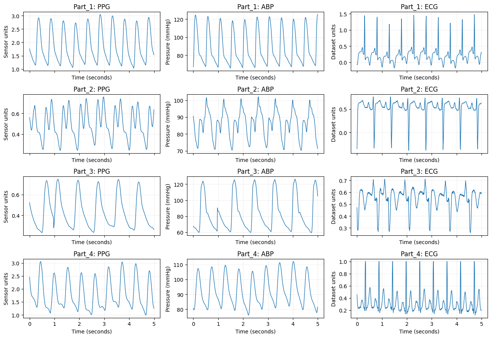
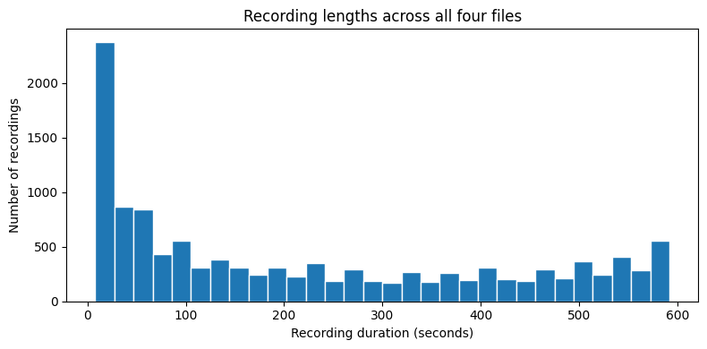
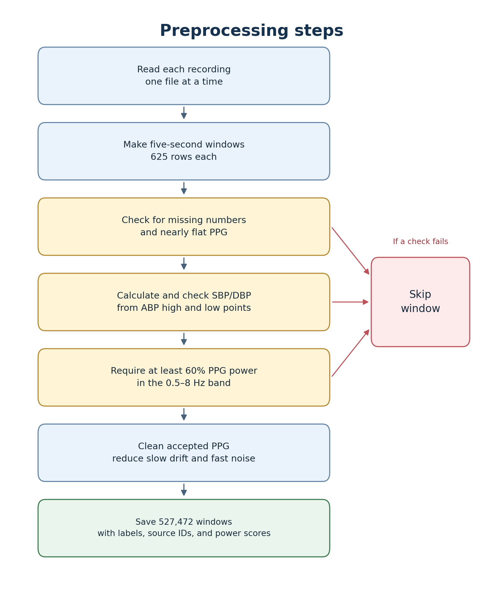
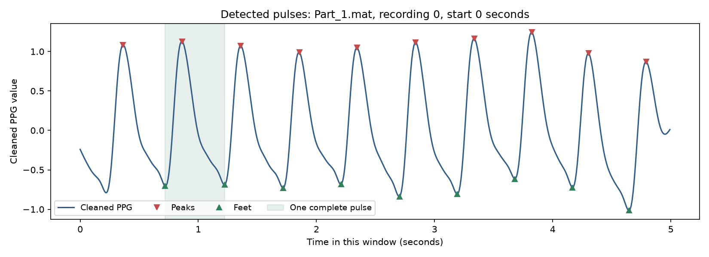
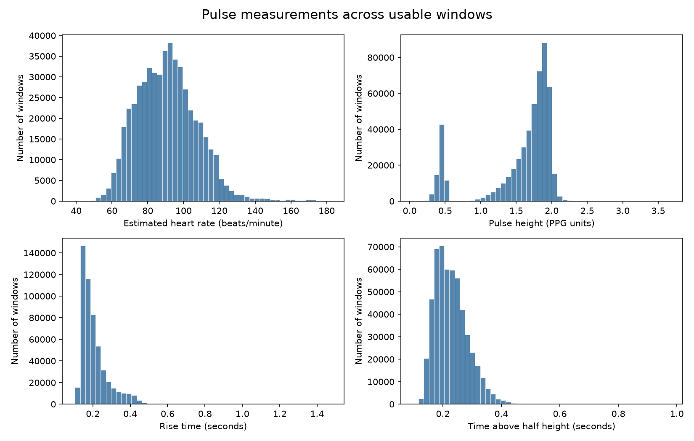
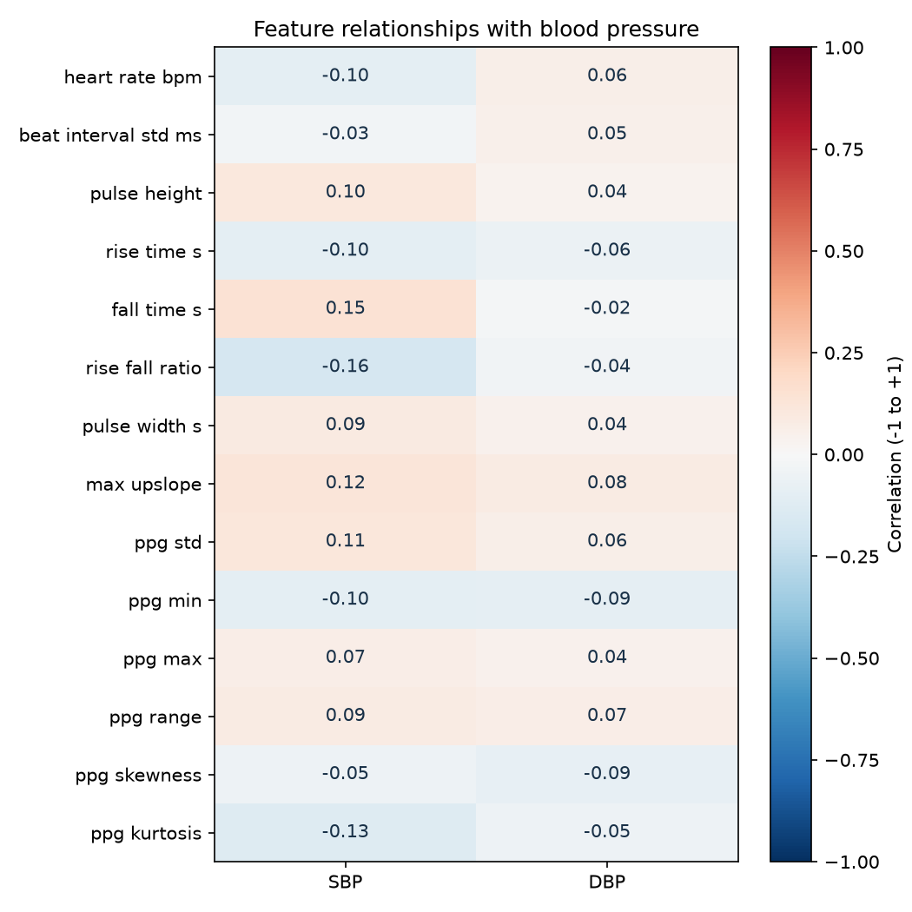
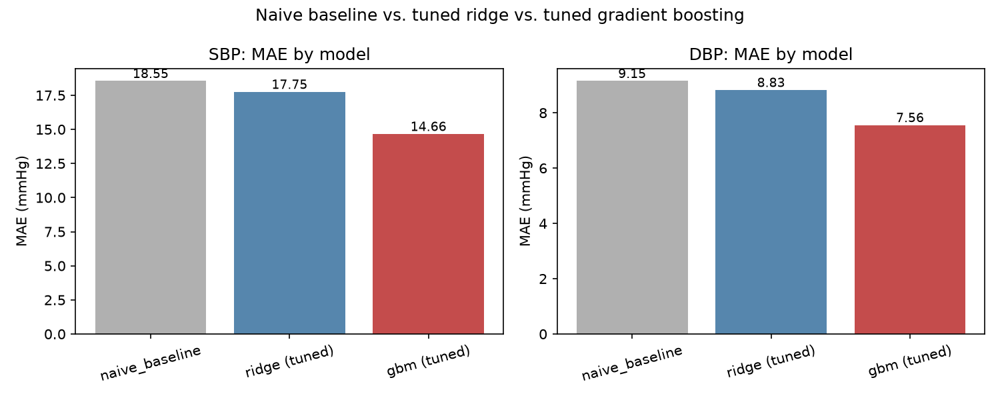
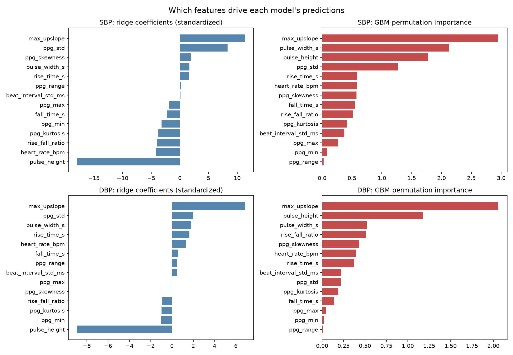

# Notebook results

## [dataset_overview.ipynb](../notebooks/dataset_overview.ipynb)

**Purpose:** Explore the data.

### Findings

- There are **four files**.
- Each file holds **3,000 separate tables**. Each table is one recording.
- Each row contains three readings taken together:
  - **PPG:** Light measures changes in blood under the skin.
  - **ABP:** Measures blood pressure inside an artery.
  - **ECG:** Measures the heart's electrical activity.
- **125 rows make one second** of recording.
- Each recording can have a different length.
- A five-second piece contains **625 rows**.

### Signal graphs

- The lines show how readings rise and fall over time.
- Moving from left to right means time is passing.
- Each row of graphs shows an example from one file.
- Each column shows one signal: PPG, ABP, or ECG.
- These graphs show five seconds from one recording in each file.

### Recording-length graph

- This graph shows how many recordings are short or long.
- Left means shorter recordings. Right means longer recordings.
- A taller bar means more recordings have that length.

## [preprocess.ipynb](../notebooks/preprocess.ipynb)

**Purpose:** Prepare the signals for training.

### Preprocessing steps

- Open one file at a time and read each recording.
- Take **625 rows** at a time to make five-second windows. Leave shorter leftovers unused.
- Skip windows with missing numbers or nearly flat PPG.
- Calculate **SBP from ABP high points** and **DBP from low points**, using the middle values. Require at least three of each, with SBP higher than DBP.
- Skip windows with **less than 60% power between 0.5 and 8 Hz**.
- Clean the accepted PPG with a 0.5–8 Hz filter to reduce slow drift and fast noise.
- Save the cleaned windows, blood-pressure labels, source IDs, power scores, and counts.

### Preprocessing diagram

- Follow the arrows from top to bottom.
- A window that fails a check goes to “Skip window.”

### Findings

- Started with **528,828 complete five-second windows**.
- Rejected **22** with too few ABP high or low points.
- Rejected **10** where SBP was not higher than DBP.
- Rejected **1,324** remaining windows below the power cutoff.
- Kept **527,472 windows**.
- No windows were rejected for missing numbers or nearly flat PPG in this run.
- No fixed upper or lower blood-pressure limits were used.

### What we saved

- `data/processed_dataset.npz`: one file holding the cleaned PPG windows, SBP/DBP labels, source IDs, and power scores.
- **Source IDs:** the original file, recording number, and starting row for each window.
- [data_pipeline_stats.json](data_pipeline_stats.json): kept/rejected counts and the settings used.

## [ppg_feature_extraction.ipynb](../notebooks/ppg_feature_extraction.ipynb)

**Purpose:** Turn cleaned PPG windows into pulse measurements for a model.

### Feature extraction steps

- Load the cleaned windows from `data/processed_dataset.npz`.
- Find pulse tops (**peaks**) and the low points between them (**feet**).
- Measure heart rate, pulse height, pulse width, rise/fall time, and other signal features.
- Skip windows where fewer than two complete pulses can be measured or a measurement is undefined.
- Keep the saved SBP/DBP labels and source IDs matched to each window.
- Save one row per usable five-second window in `data/ppg_features.csv`.

### Example measurements

- Source: `Part_1.mat`, recording **0**, starting row **0**.
- Estimated heart rate: **121.8 beats per minute**.
- Average rise time: **0.139 seconds**.
- Average fall time: **0.352 seconds**.
- These are calculated from the detected pulses, not separate confirmed measurements.

### Findings

- Started with **527,472 cleaned windows**.
- Kept **527,467 windows**, with **14 PPG features** for each.
- Skipped **5** with too few complete pulses.
- Skipped **0** for undefined measurements.
- The strongest single relationship with SBP was the **rise-time/fall-time ratio** (**-0.164**).
- The strongest single relationship with DBP was the **lowest PPG reading** (**-0.092**).
- Both relationships were weak. We have not tested prediction accuracy.
- Saved labels and source IDs were checked against the cleaned dataset.

### Detected-pulse graph

- The line shows five seconds of cleaned PPG.
- Red markers show pulse tops. Green markers show low points.
- The shaded area marks one complete pulse used for measurements.

### Feature graphs

- Each graph shows how a measurement varies across usable windows.
- Taller bars mean more windows have that value.

### Feature relationships with blood pressure

- Positive numbers mean the feature and blood pressure tend to rise together.
- Negative numbers mean they tend to move in opposite directions.
- Numbers near zero mean little straight-line relationship. This does not tell us how well features work together in a model.

### What we saved

- `data/ppg_features.csv`: the feature table, generated locally and ignored by Git because it is large.
- **Inputs:** 14 pulse and signal measurements.
- **Answers:** the SBP and DBP labels from preprocessing.
- **Source IDs:** file, recording number, and starting row. Keep each recording together when splitting data later; these are not patient IDs.
- **Extra information:** complete-pulse count and the saved PPG power score.

## [modeling.ipynb](../notebooks/modeling.ipynb)

**Purpose:** Test whether the 14 PPG features can predict SBP and DBP, tune each model's settings properly, and compare the result against a do-nothing baseline.

### Modeling steps

- Load `data/ppg_features.csv`.
- Split into train and test sets **by whole recording**, not by row, so a recording's five-second windows never end up on both sides. This stops the model from "cheating" on windows that look almost identical to ones it already trained on. **The test set is set aside here and is not touched again until the very last step.**
- Build a **naive baseline**: always guess the training set's average SBP and DBP, ignoring the PPG features entirely. This is the number any real model has to beat.
- **Tune each model's hyperparameters** using the training set only, never the test set:
  - Split the training recordings into 5 groups (folds), again keeping each recording's windows together within one fold.
  - For every candidate setting, train on 4 folds and check error on the 5th, rotating which fold is held out, then average the error across all 5 folds. This is called grouped K-fold cross-validation.
  - **Ridge regression:** tried 7 values of `alpha` (how strongly it shrinks the coefficients), from 0.001 to 1000.
  - **Gradient boosting:** tried 45 combinations of 3 settings (`learning_rate`, `max_leaf_nodes`, `min_samples_leaf`) that control how fast and how complex the model grows.
  - The combination with the lowest average cross-validation error is kept for each target.
- Refit the winning settings on the **full** training set, then evaluate once on the held-out test recordings — the only time the test set is used.
- Explain each model's predictions: standardized coefficients for ridge, and permutation importance for gradient boosting (shuffling one feature at a time and checking how much worse predictions get).

### Findings

- Train/test split: **9,589 recordings / 420,509 windows** for training, **2,400 recordings / 106,958 windows** for testing.
- Naive baseline (always predicting the training average): **SBP 128.9 mmHg, DBP 68.1 mmHg**, giving MAE of **18.5** (SBP) and **9.2** (DBP).
- **Ridge regression's `alpha` barely mattered.** Cross-validation error was nearly flat across all 7 values (SBP error stayed at 17.57 from `alpha=0.001` through `alpha=100`, only rising slightly at `alpha=1000`). With over 400,000 training rows, there isn't much for this kind of regularization to control. `alpha=0.001` was picked for both targets, but it is effectively a tie with the next few values.
- **Gradient boosting's search picked the same, most complex setting for both targets:** `learning_rate=0.05`, `max_leaf_nodes=1000`, `min_samples_leaf=20`. This was also the slowest setting to train in the search. Because it is the most complex option *available* in the grid we tried, this is an "edge of the grid" result — a wider search might find something even better, so this should not be read as the best possible gradient boosting model, just the best one found in this search.
- **Tuned results on the test set:**
  - SBP: naive baseline MAE 18.5 &rarr; ridge (tuned) **17.7** &rarr; gradient boosting (tuned) **14.7** (RMSE 22.8 &rarr; 22.1 &rarr; 19.3).
  - DBP: naive baseline MAE 9.2 &rarr; ridge (tuned) **8.8** &rarr; gradient boosting (tuned) **7.6** (RMSE 12.0 &rarr; 11.7 &rarr; 10.6).
- Tuning gradient boosting's settings improved it further over an earlier untuned run (default settings: MAE 15.5 for SBP, 7.9 for DBP) — about 5% lower error on both targets after tuning.
- Gradient boosting outperforming ridge on both targets suggests the useful signal in these features is not purely a straight-line (linear) relationship.
- `pulse_height`, `max_upslope`, and `ppg_std` were the most important features for **both** models and **both** targets — a consistent story across two very different model types, and unchanged by tuning.
- This ranking differs from the single-feature correlations found in `ppg_feature_extraction.ipynb` (which pointed to `rise_fall_ratio` for SBP and `ppg_min` for DBP). That is expected, not a contradiction: a correlation looks at one feature alone, while a trained model's importance accounts for every feature together.
- None of these errors are close to clinical accuracy (medical guidelines look for MAE around 5 mmHg or less). These results fit the project's educational goal — showing a complete, honest pipeline — rather than a clinically usable model.

### Model comparison graph

- Each bar is one model's average error in mmHg on the test recordings.
- Shorter bars are better.
- Gray is the naive baseline, blue is tuned ridge, red is tuned gradient boosting.

### Feature importance graphs

- Left column: ridge coefficients. Bars further from zero (in either direction) mean a stronger effect on the prediction; the sign shows the direction.
- Right column: gradient boosting permutation importance. Longer bars mean the model relied on that feature more.
- Top row is SBP, bottom row is DBP.

### What we saved

- `results/graphs/model_comparison.png` and `results/graphs/feature_importance.png`.
- No model files are saved by this notebook; re-running it repeats the full hyperparameter search and refits all four final models from `data/ppg_features.csv`.
- The modeling code itself lives in `src/` (`data_split.py`, `baseline.py`, `models.py`, `importance.py`, `cross_validation.py`) so the same functions can be reused or extended without copying code between notebooks.
