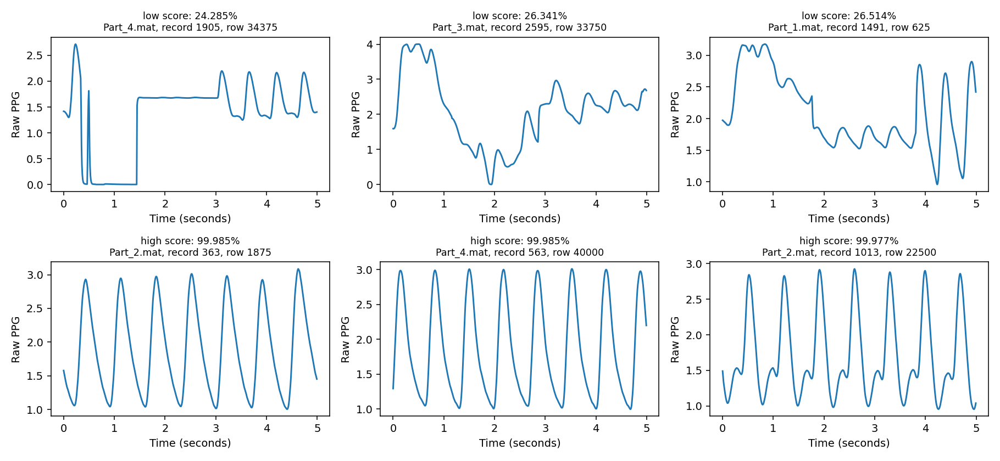
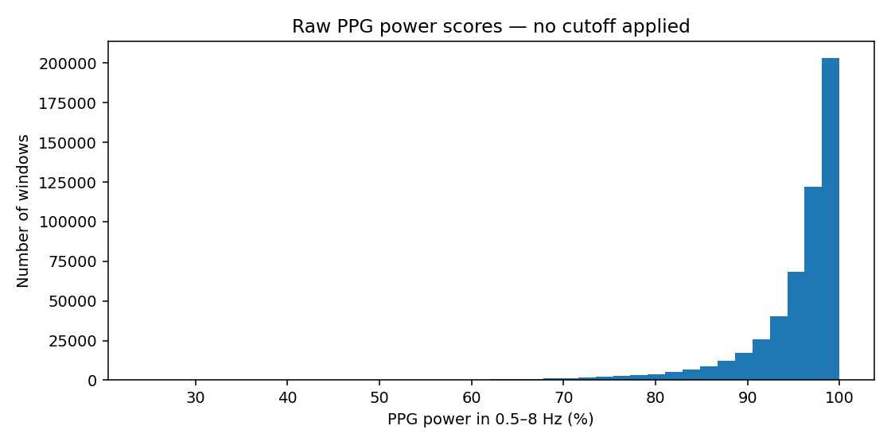

# PPG power check

**Purpose:** Record power scores before choosing a cutoff.

Notebook: [ppg_power_check.ipynb](../notebooks/ppg_power_check.ipynb)

- The score is the percentage of raw PPG power between **0.5 and 8 Hz**.
- It is measured before filtering, because filtering would change the score.
- It is not a percentage of accuracy or a guarantee of signal quality.
- Preprocessing now records the score without using a percentage cutoff.

## What we measured

- Checked **528,828 complete windows** across all four files.
- Every window had a measurable score.
- **1,326 windows (0.251%)** scored below the old 60% rule.
- The middle score was **97.299%**.
- These counts cover all candidate windows, before the other preprocessing checks.
- Full preprocessing kept **528,796 windows**. It rejected 22 for too few ABP points and 10 for SBP/DBP ordering.
- **1,324 accepted windows** scored below 60%. They were kept because no power-percentage cutoff was applied.
- The dataset stores scores as fractions from 0 to 1; multiply by 100 for percentages.

## Examples we inspected

- The top row shows three low-score examples from different recordings.
- They show flat sections, jumps, or large changes in the signal's baseline.
- The bottom row shows three high-score examples with more regular pulse shapes.
- These six examples were selected by score. They are not a random sample or independently labeled good/bad signals.

- Most windows have high scores. A small number have low scores.

## Why we are not choosing a cutoff yet

- A smooth **artificial 0.6 Hz wave** scored only **23.086%**, even though its frequency is inside the selected band.
- The frequency estimate uses 256-row chunks, giving frequency steps of about 0.488 Hz. Power near the lower boundary can spread into bins outside the band.
- A low score can therefore reflect the scoring method as well as a poor signal.
- A high score also cannot detect every kind of bad signal.
- No model accuracy or independently labeled signal-quality test was measured here.

Evidence: [measured summary](ppg_power_summary.json), [example locations](ppg_power_examples.csv), and [artificial-wave checks](ppg_power_tests.json).

The full window scores are saved locally in `data/ppg_power_scores.csv`. The large file is ignored by Git.
